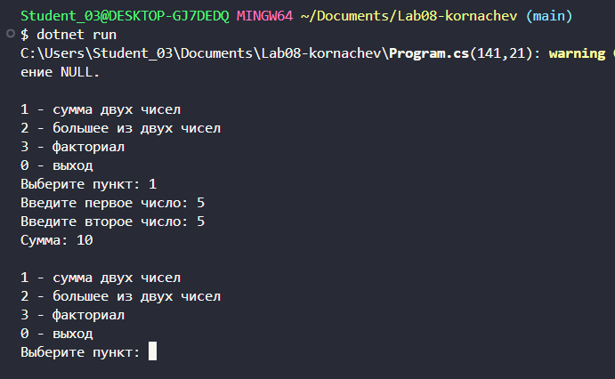
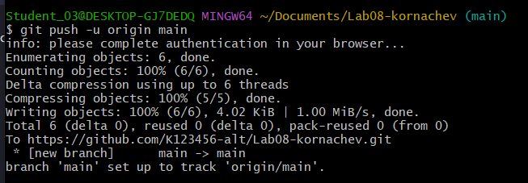

# Практическая работа №8. Методы
**Корначев Кирилл Александрович**
**Группа: ИСП-243**
**Дата: 17.10.2026**
## Что изучено.
- *объявлять и вызывать собственные методы*
- *передавать в метод данные через параметры*
- *возвращать результат через return*

